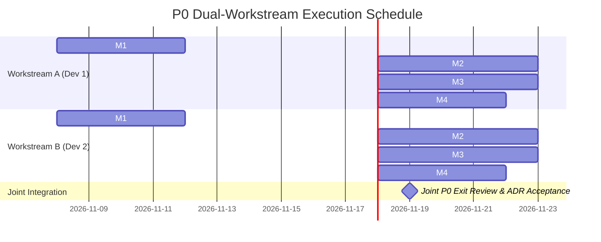

# StrataMQ Dual-Workstream Parallel Engineering & Tracking Plan

**Coordination Framework and Task Division for Two Parallel Developers**  
*Architecture Baseline: November 2026 — Target: P0 Validation & Tournament Exit*

---

## 1. Division Strategy & Plane Separation

To enable two developers to work at maximum velocity with **zero git merge conflicts** and **independent feedback loops**, the remaining work is divided along StrataMQ's primary architectural boundary: the **State & Networking Plane** and the **Record & Storage Plane**.

```
┌────────────────────────────────────────────────────────────────────────┐
│                   WORKSTREAM A: STATE & WIRE PLANE                     │
│                  (Developer 1: Protocol & Consumption)                 │
│                                                                        │
│   crates/protocol-core  ───>  crates/subscription  ───>  crates/server │
│   - NMP Draft 0 Framing      - Keyed Queue Completion   - TCP Listener │
│   - Demand Windows           - Timer Wheel Retries      - Client API   │
│   - Delivery Tournament      - Transport Tournament                    │
└───────────────────────────────────┬────────────────────────────────────┘
                                    │ Shared Integration Contracts
                                    │ (RecordBatchV0, Clock, Durability)
┌───────────────────────────────────▼────────────────────────────────────┐
│                  WORKSTREAM B: RECORD & STORAGE PLANE                  │
│                   (Developer 2: Persistence & Sharding)                │
│                                                                        │
│   crates/record  ───>  crates/storage-core  ───>  crates/sharding      │
│   - RecordBatch v0     - Local WAL / Hybrid      - Virtual Sharding    │
│   - Codec & CRC32C     - Storage Tournament      - Sharding Tournament │
│   - Fuzz Targets       - Failure Injection       - bench-core Harness  │
└────────────────────────────────────────────────────────────────────────┘
```

---

## 2. Workstream Ownership Matrix

| Dimension | **Workstream A: State & Networking** | **Workstream B: Storage & Sharding** |
|---|---|---|
| **Assigned Owner** | **Developer 1** | **Developer 2** |
| **Primary Crates** | [`crates/subscription`](file:///Users/harisrovca/Documents/Workspaces/stratamq/crates/subscription), [`crates/protocol-core`](file:///Users/harisrovca/Documents/Workspaces/stratamq/crates/protocol-core), [`crates/server`](file:///Users/harisrovca/Documents/Workspaces/stratamq/crates/server) | [`crates/record`](file:///Users/harisrovca/Documents/Workspaces/stratamq/crates/record), [`crates/journal`](file:///Users/harisrovca/Documents/Workspaces/stratamq/crates/journal), [`crates/storage-core`](file:///Users/harisrovca/Documents/Workspaces/stratamq/crates/storage-core), [`crates/sharding`](file:///Users/harisrovca/Documents/Workspaces/stratamq/crates/sharding), [`crates/bench`](file:///Users/harisrovca/Documents/Workspaces/stratamq/crates/bench) |
| **Focus Areas** | Wire protocol, demand flow control, leases, retries, client sessions | Batch codecs, disk persistence, virtual sharding, benchmark harness, failure injection |
| **Tournaments Owned** | Transport (`NET-L1`, `NET-W1`), Delivery (`DEL-S1`) | Storage (`STORE-W1`, `STORE-S1`, `STORE-R1`), Sharding (`SHARD-U1`, `SHARD-R1`), Codec (`FORMAT-1`) |
| **ADRs Owned** | `ADR-P0-005`, `ADR-P0-006`, `ADR-P0-010` | `ADR-P0-001`, `ADR-P0-002`, `ADR-P0-003`, `ADR-P0-004`, `ADR-P0-007`, `ADR-P0-008`, `ADR-P0-009` |

---

## 3. Shared Integration Contracts (Contract-First Parallelism)

Before starting independent implementation, both developers adhere to these shared Rust contracts in `crates/types` and `crates/record`. Neither developer changes these signatures without explicit alignment:

### Contract 1: Monotonic Clock Provider (`strata-types`)
Prevents wall-clock skew in Journal OCC and lease timing:
```rust
pub trait Clock: Send + Sync + 'static {
    fn now_millis(&self) -> u64;
}

#[derive(Debug, Clone, Default)]
pub struct SystemClock;
impl Clock for SystemClock {
    fn now_millis(&self) -> u64 {
        std::time::SystemTime::now()
            .duration_since(std::time::UNIX_EPOCH)
            .map(|d| d.as_millis() as u64)
            .unwrap_or(0)
    }
}
```

### Contract 2: `RecordBatchV0` Header & Data Representation (`strata-record`)
Used by Developer 2 for disk/WAL persistence and by Developer 1 for NMP framing:
```rust
#[repr(C)]
#[derive(Debug, Clone, PartialEq, Eq)]
pub struct RecordBatchHeader {
    pub total_len: u32,
    pub format_version: u8,
    pub flags: u8,
    pub compression: u8, // 0=None, 1=LZ4, 2=Zstd
    pub reserved: u8,
    pub record_count: u32,
    pub producer_id: u64,
    pub producer_epoch: u32,
    pub first_sequence: u64,
    pub first_timestamp: u64,
    pub crc32c: u32,
}
```

### Contract 3: Demand Window Credit Primitive (`strata-types` / `strata-protocol-core`)
Used by Developer 1 for NMP wire control and by Developer 2's benchmark consumers:
```rust
#[derive(Debug, Clone, Copy, PartialEq, Eq)]
pub struct DemandWindow {
    pub max_records: u32,
    pub max_bytes: u32,
    pub wait_ms: u32,
    pub continuous: bool,
}
```

---

## 4. Phase-by-Phase Parallel Milestones



### Milestone 1: Core Domain Hardening
- **Developer 1 (Workstream A)**:
  - Complete [`KeyedWorkState`](file:///Users/harisrovca/Documents/Workspaces/stratamq/crates/subscription/src/keyed.rs): Implement item completion trigger to pop the next pending record for that key.
  - Implement `KeyFailurePolicy` (`StrictBlock` vs `Relaxed`).
  - Replace linear scan in `WorkState::expire_leases()` and `promote_retries()` with a time-ordered index / timer wheel.
- **Developer 2 (Workstream B)**:
  - Implement `Clock` trait and replace `SystemTime::now()` in `Journal` with injected clock.
  - Implement `RecordBatchV0` encoder/decoder with CRC32C validation in `crates/record`.
  - Add producer epoch and sequence fields to `Record`.
  - Set up `cargo-fuzz` target for `RecordBatchV0`.

### Milestone 2: Wire Framing & Sharding Tournament
- **Developer 1 (Workstream A)**:
  - Implement NMP 24-byte `FrameHeader` encoder/decoder in `crates/protocol-core`.
  - Implement frame parser with defensive checks (`max_frame_bytes`).
  - Implement session handshake (`HELLO` and `WELCOME`) with capability negotiation flags.
- **Developer 2 (Workstream B)**:
  - Build `crates/bench`: workload generator, HDR histogram latency samplers, and common result JSON schema.
  - Implement `ShardingExperiment` trait in `crates/sharding`:
    - Candidate A: Coarse physical partitions.
    - Candidate B: Virtual sharding (65k/262k) with Rendezvous Hashing (HRW).
  - Execute `SHARD-U1`, `SHARD-H1`, `SHARD-R1` benchmarks and generate report.

### Milestone 3: Transport Delivery & Storage Tournament
- **Developer 1 (Workstream A)**:
  - Implement TCP connection actor and multiplexed session manager in `crates/protocol-core` / `crates/server`.
  - Implement `DEMAND` and `WINDOW_UPDATE` credit tracking engine.
  - Implement `PUBLISH_BATCH`, `DELIVER_BATCH`, `ACK_BATCH`, `NACK`, `EXTEND_LEASE` opcodes.
- **Developer 2 (Workstream B)**:
  - Implement `StorageExperiment` trait in `crates/storage-core`:
    - Candidate A: Local-first WAL + local segment writer.
    - Candidate B: Hybrid WAL + object storage simulator (S3 API).
    - Candidate C: Object-primary writer.
  - Execute `STORE-W1` (interactive work), `STORE-S1` (streaming), `STORE-R1` (cold replay) benchmarks.

### Milestone 4: Tournaments & P0 Exit Review
- **Developer 1 (Workstream A)**:
  - Run Delivery Tournament (`DEL-S1`: Demand-window vs Pull vs Push).
  - Run Transport Tournament (`NET-L1`, `NET-W1`: TCP vs QUIC multiplexing).
  - Draft reports for `ADR-P0-005` and `ADR-P0-006`.
- **Developer 2 (Workstream B)**:
  - Run Codec Tournament (Shared wire/storage format vs Normalized translation).
  - Run Mixed-Workload Isolation benchmark (`MIX-1`, `MIX-2`).
  - Run Crash/Failure Injection suite (`FAIL-1`, `FAIL-2`).
  - Draft reports for `ADR-P0-001`, `ADR-P0-003`, `ADR-P0-007`, `ADR-P0-009`.

---

## 5. Live Tracking Matrix & Progress Checklist

Use this table as the authoritative daily check-in board.

| Task ID | Component | Owner | Dependencies | Status | PR / Branch | Notes |
|---|---|---|---|---|---|---|
| **A-01** | Keyed Work Queue Completion & Lifecycle | Dev 1 | None | 🟡 Pending | `dev1/keyed-work-lifecycle` | Unblock pending items on ACK/DLQ |
| **A-02** | Work Queue Timer-Wheel Optimization | Dev 1 | None | ⚪ Planned | `dev1/timer-wheel-leases` | Fix $O(N)$ linear scan on lease expiry |
| **A-03** | NMP Frame Header & Framing Codec | Dev 1 | Contract 2 | ⚪ Planned | `dev1/nmp-frame-codec` | 24-byte header, defensive size checks |
| **A-04** | Capability Negotiation (`HELLO`/`WELCOME`)| Dev 1 | A-03 | ⚪ Planned | `dev1/nmp-session-handshake`| Bitflags for batch, demand, leases |
| **A-05** | Demand Window Flow Accounting | Dev 1 | A-03, A-04 | ⚪ Planned | `dev1/demand-window-engine` | `DEMAND` and `WINDOW_UPDATE` logic |
| **A-06** | TCP Multiplexing Connection Actor | Dev 1 | A-05 | ⚪ Planned | `dev1/tcp-connection-actor` | Tokio framed async read/write loop |
| **A-07** | Delivery Tournament (`DEL-S1`) | Dev 1 | A-05, B-03 | ⚪ Planned | `dev1/delivery-tournament` | Compare demand vs pull vs push |
| **A-08** | Transport Tournament (`NET-L1`/`W1`) | Dev 1 | A-06, B-03 | ⚪ Planned | `dev1/transport-tournament`| TCP vs QUIC latency/loss comparison |
| **B-01** | Clock Trait & Monotonic Time Injection | Dev 2 | None | ⚪ Planned | `dev2/monotonic-clock` | Inject mockable clock in Journal |
| **B-02** | `RecordBatchV0` Binary Layout & CRC32C | Dev 2 | Contract 2 | ⚪ Planned | `dev2/record-batch-v0` | Full batch framing with producer seq |
| **B-03** | Benchmark Core Harness & HDR Latency | Dev 2 | None | ⚪ Planned | `dev2/bench-core-harness` | Standard result schema & workload gen |
| **B-04** | Sharding Tournament (Virtual vs Coarse) | Dev 2 | B-03 | ⚪ Planned | `dev2/sharding-tournament` | Rendezvous HRW vs partition hashing |
| **B-05** | Storage Tournament (Local vs Hybrid WAL) | Dev 2 | B-02, B-03 | ⚪ Planned | `dev2/storage-tournament` | WAL append & commit receipts |
| **B-06** | Codec Fuzz Target (`cargo-fuzz`) | Dev 2 | B-02 | ⚪ Planned | `dev2/fuzz-record-batch` | Continuous fuzz corpus for batch decode |
| **B-07** | Mixed-Workload Isolation (`MIX-1`/`MIX-2`)| Dev 2 | B-05, A-02 | ⚪ Planned | `dev2/mixed-workload-bench`| Measure p99 degradation under replay |
| **B-08** | Crash Recovery & Failure Injection | Dev 2 | B-05 | ⚪ Planned | `dev2/failure-injection` | SIGKILL, truncated WAL, stale leases |

*Status Legend: 🟢 Done | 🟡 In Progress | ⚪ Planned | 🔴 Blocked*

---

## 6. Git Branching & Coordination Rules

1. **Branch Naming**:
   - Developer 1: `dev1/<task-id>-<description>` (e.g. `dev1/A-01-keyed-work-lifecycle`)
   - Developer 2: `dev2/<task-id>-<description>` (e.g. `dev2/B-02-record-batch-v0`)
2. **Rebasing & Trunk Integration**:
   - Both developers branch from and merge into `dev`.
   - Small, incremental PRs ($< 400$ lines) merged frequently.
   - Always rebase on latest `origin/dev` before opening PRs:
     ```bash
     git fetch origin
     git rebase origin/dev
     ```
3. **Automated Verification Pre-Merge Gate**:
   Every PR must execute cleanly before merging:
   ```bash
   cargo fmt --all -- --check
   cargo clippy --workspace --all-targets -- -D warnings
   cargo test --workspace
   ```
4. **Contract Modification Protocol**:
   - If a change is needed in shared contract files (`strata-types`, shared traits), the proposing developer opens a dedicated RFC pull request tagged `[CONTRACT]` and both developers must approve before merging.
