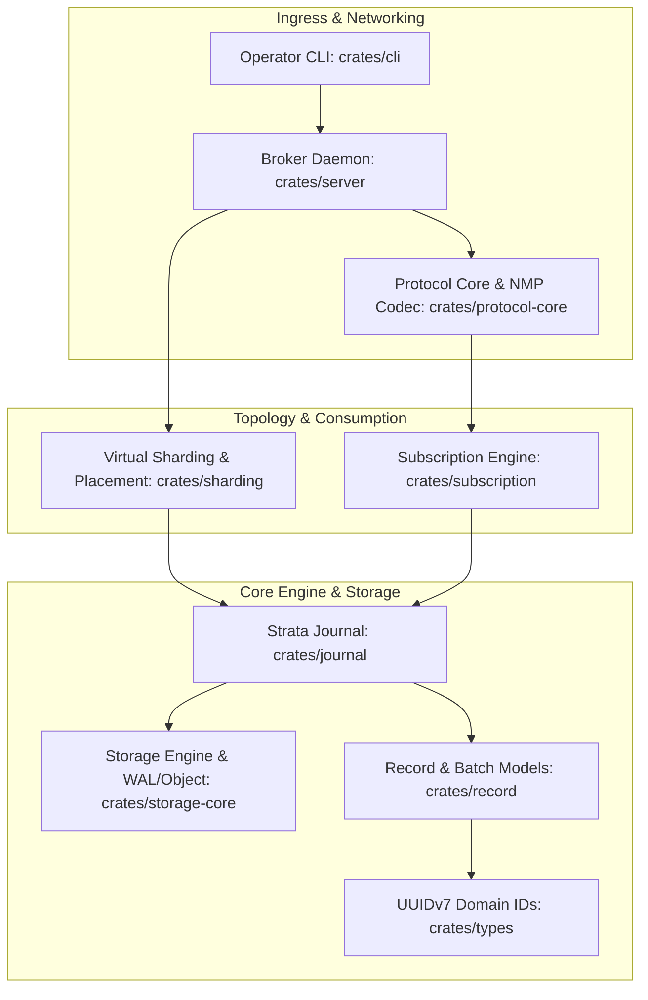
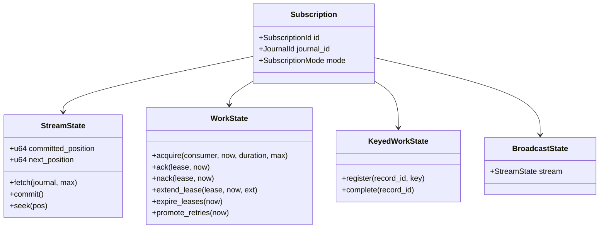

# StrataMQ Architecture Overview

**Unified Event Streaming and Reliable Messaging Engine**  
*Architecture Baseline: November 2026*

---

## 1. System Philosophy & Dual-Plane Architecture

StrataMQ collapses the traditional division between event streaming logs (e.g. Kafka) and message queues (e.g. RabbitMQ). Instead of forcing queue emulations on a log or layering logs on a queue, StrataMQ decouples the system into two independent planes:

```
RECORD PLANE (Immutable Data)
┌────────────────────────────────────────────────────────────────────────┐
│ Journal ──> Record Batches (v0) ──> Segments ──> Retention / S3 Tier   │
└────────────────────────────────────┬───────────────────────────────────┘
                                     │ Shared Records
STATE PLANE (Mutable Consumption)    │ (Zero Payload Duplication)
┌────────────────────────────────────▼───────────────────────────────────┐
│ Subscription                                                           │
│   ├── Stream Mode: Cursor Offsets, Checkpoints, Historical Seek        │
│   ├── Work Mode: Leased Work Items, Generation Fencing, Retries, DLQ   │
│   ├── Keyed Mode: Per-Key Sequential Dispatch, Hotspot Isolation       │
│   ├── Broadcast Mode: Independent Per-Subscriber Observation Cursors   │
│   └── Replay Branches: Isolated Historical Investigation Tracks        │
└────────────────────────────────────────────────────────────────────────┘
```

- **Record Plane**: Stores immutable published record batches. Committed payloads and metadata are permanent and never deleted or mutated upon consumer acknowledgment.
- **State Plane**: Stores subscription-specific consumer cursors, leases, retry counters, and dead-letter statuses.

---

## 2. Layered Crate Architecture

The StrataMQ codebase is organized into modular, single-responsibility Rust crates adhering strictly to `#![forbid(unsafe_code)]` in all core domain logic:



### Layer Roles
1. **[`crates/types`](file:///Users/harisrovca/Documents/Workspaces/stratamq/crates/types/src/lib.rs) (`strata-types`)**: Strongly-typed newtype wrappers around UUIDv7 (`RecordId`, `JournalId`, `SubscriptionId`, `ConsumerId`, `ProducerId`, `LeaseId`). Provides k-sortable chronological ordering and zero coordination overhead.
2. **[`crates/record`](file:///Users/harisrovca/Documents/Workspaces/stratamq/crates/record/src/lib.rs) (`strata-record`)**: Models for `ProposedRecord` (uncommitted) and immutable `Record`, as well as `RecordBatchV0` binary encoding.
3. **[`crates/journal`](file:///Users/harisrovca/Documents/Workspaces/stratamq/crates/journal/src/lib.rs) (`strata-journal`)**: In-memory and storage-backed append log with per-subject revision tracking and optimistic concurrency control (`ExpectedRevision`).
4. **[`crates/subscription`](file:///Users/harisrovca/Documents/Workspaces/stratamq/crates/subscription/src/lib.rs) (`strata-subscription`)**: State machines for Stream, Work, Keyed, and Broadcast consumption modes.
5. **[`crates/protocol-core`](file:///Users/harisrovca/Documents/Workspaces/stratamq/crates/protocol-core/src/lib.rs)**: Native Messaging Protocol (NMP) binary framing, opcodes, and demand-window bookkeeping.
6. **[`crates/storage-core`](file:///Users/harisrovca/Documents/Workspaces/stratamq/crates/storage-core/src/lib.rs)**: Storage engine traits, local WAL, segment compaction, and S3-compatible tiering.
7. **[`crates/sharding`](file:///Users/harisrovca/Documents/Workspaces/stratamq/crates/sharding/src/lib.rs)**: Virtual shard hashing (rendezvous hashing) and storage-group placement.
8. **[`crates/bench`](file:///Users/harisrovca/Documents/Workspaces/stratamq/crates/bench/src/lib.rs)**: Architecture tournament harnesses and HDR latency samplers.
9. **[`crates/server`](file:///Users/harisrovca/Documents/Workspaces/stratamq/crates/server/src/main.rs)** & **[`crates/cli`](file:///Users/harisrovca/Documents/Workspaces/stratamq/crates/cli/src/main.rs)**: Standalone broker daemon and operator CLI.

---

## 3. Ingestion & Optimistic Concurrency Control (OCC)

Each record appended to a Journal may optionally belong to a `Subject` (e.g. `orders.1234`). When a subject is specified, StrataMQ assigns a monotonically increasing revision number scoped strictly to that subject.

Producers can specify an `ExpectedRevision` to perform atomic conditional updates without distributed locks:


---

## 4. Multi-Modal Subscriptions



### 4.1. Stream Mode (`StreamState`)
Provides linear sequential consumption with durable cursor checkpointing (`commit()`), uncommitted rollbacks (`reset_to_committed()`), and arbitrary historical replays (`seek()`).

### 4.2. Work Mode (`WorkState`)
Provides competing consumer delivery with exclusive, time-bounded leases:
- **Generation Fencing**: Every redelivery increments the item's `generation`. Stale worker acknowledgments fail deterministically with `WorkError::StaleGeneration`.
- **Heartbeat Extensions**: Long tasks renew active leases via `extend_lease` without generation bumps.
- **Configurable Retries**: Supports `Immediate`, `Fixed`, and `Exponential` backoff.
- **Dead-Letter State**: Records that exceed `max_attempts` transition to `WorkStatus::DeadLettered` without payload copying.

### 4.3. Keyed Work Mode (`KeyedWorkState`)
Guarantees strictly serial delivery for records bearing the same partition key. While one record for key $K$ is actively leased by a consumer, subsequent records for $K$ are queued in `pending_by_key`. Unrelated keys execute concurrently.

### 4.4. Broadcast Mode (`BroadcastState`)
Enables independent pub/sub fanout. Each subscriber advances an isolated stream cursor over the shared journal records without duplicating payloads.

---

## 5. Native Messaging Protocol (NMP) & Demand Windows

NMP is a binary multiplexed wire protocol designed specifically for StrataMQ.

### Receiver-Authorized Demand Windows
Rather than forcing a binary choice between push and pull, NMP uses receiver-authorized **Demand Windows**:
- Consumer authorizes a delivery budget: `DEMAND { max_records: 128, max_bytes: 16MiB, deadline_ms: 500, continuous: true }`.
- Broker delivers batches (`DELIVER_BATCH`) up to the authorized budget.
- Consumer replenishes credits with `WINDOW_UPDATE`.
- If credits reach zero, delivery stops immediately, bounding broker and client memory under all load conditions.

---

## 6. Sharding and Storage Architecture

### Virtual Sharding (Hiding Physical Topology)
- Clients never see physical partition IDs.
- Record keys hash into **65,536 or 262,144 virtual shards**.
- Virtual shards are mapped onto a smaller set of **Storage Groups** using rendezvous hashing.
- Rebalancing moves virtual shards between storage groups without changing record IDs or client code.

### Storage Classes & Durability Profiles
Configurable per journal:
1. `low-latency`: Replicated NVMe WAL + local segments (sub-millisecond work queues).
2. `balanced`: Durable WAL + asynchronous object storage upload to S3 (default for mixed workloads).
3. `economical`: Object-primary streaming for high-retention telemetry and cold audit logs.

---

## 7. Mixed-Workload Resource Isolation

To allow heavy historical replays and segment compaction to coexist with latency-sensitive work queues, the broker enforces five priority classes:
1. `critical`: Commit path, heartbeats, durable metadata.
2. `interactive`: Work queue acquisition and acknowledgments.
3. `normal`: Streaming consumption.
4. `background`: Segment compaction, object storage uploads.
5. `recovery`: Replica catch-up and snapshot restore.

Resource budgets ensure interactive delivery maintains $p99 < 2\times$ baseline even while background maintenance is saturated.
