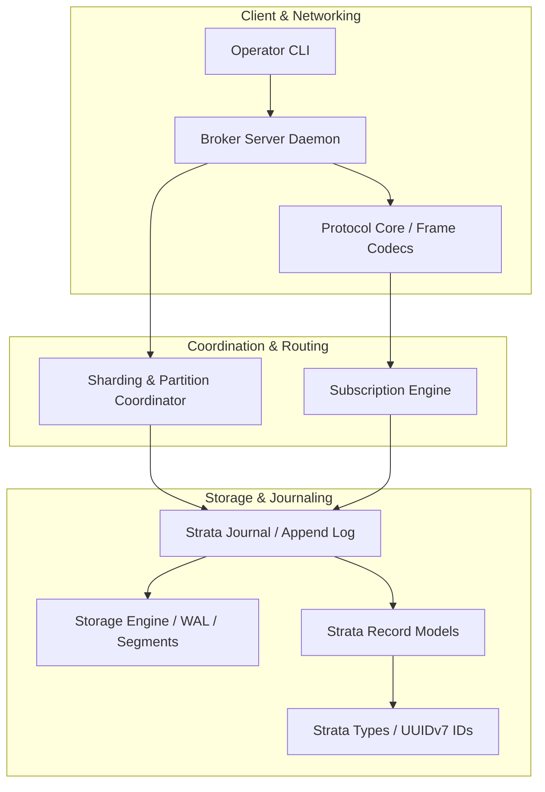
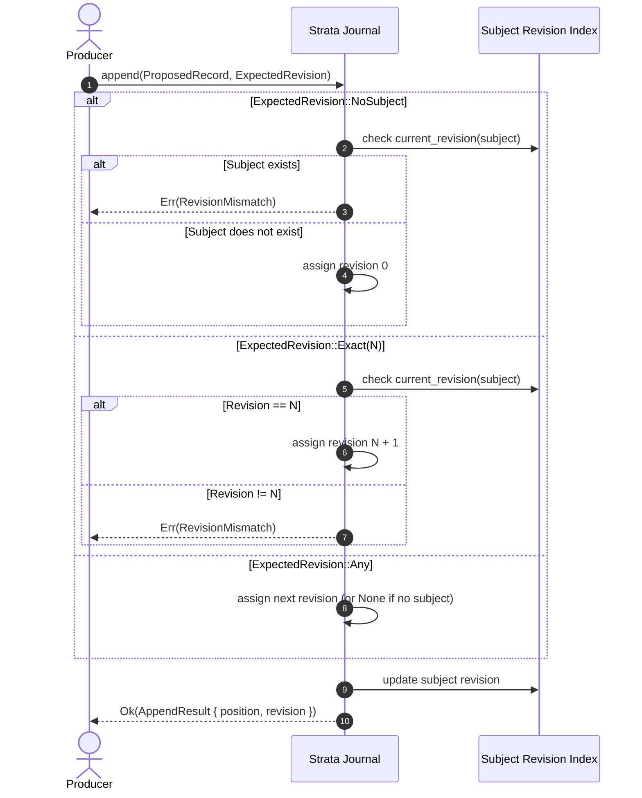
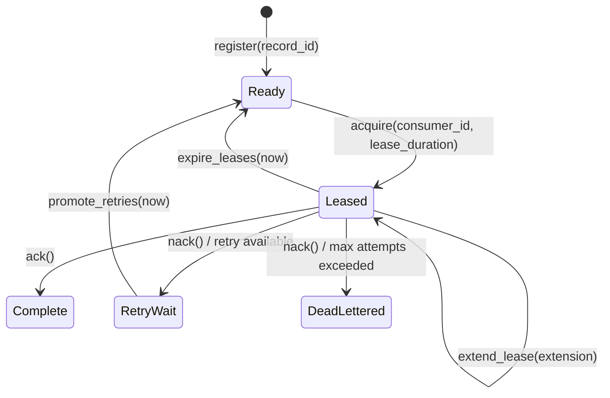

# StrataMQ Architecture Overview

StrataMQ is structured as a layered message broker and event-streaming engine. It decouples append-only log ingestion from message consumption topologies, allowing the same underlying journal to be read sequentially as a stream or processed concurrently as a distributed work queue.

---

## 1. System Layers

### Layer Descriptions

1. **Foundational Types (`strata-types`)**:
   - Centralizes domain identity via strongly-typed newtype wrappers around UUIDv7.
   - Eliminates primitive obsession (`RecordId` cannot be confused with `ConsumerId` or `JournalId`).
   - Ensures natural chronological order (k-sortable) across records and transactions.

2. **Record Models (`strata-record`)**:
   - Defines `ProposedRecord` (uncommitted client intent) and `Record` (immutable committed entry).
   - Records contain timestamps, optional subjects, revisions, partition keys, structured headers, and payload bytes.

3. **Journal Engine (`strata-journal`)**:
   - Maintains an append-only sequence of committed records.
   - Tracks per-subject monotonic revisions (`revisions: HashMap<Subject, u64>`).
   - Evaluates `ExpectedRevision` checks atomically prior to writing to the log.

4. **Subscription Engine (`strata-subscription`)**:
   - Manages consumer state machines on top of the journal.
   - Provides multiple delivery semantics: Stream, Work Queue, Keyed Work, and Broadcast.

5. **Storage, Networking, and Clustering (`storage-core`, `protocol-core`, `server`, `sharding`)**:
   - Manages physical persistence, wire serialization, TCP/multiplexing, and cluster partition distribution.

---

## 2. Ingestion & Optimistic Concurrency Control

When a producer writes to a subject (e.g. `orders.1234`), concurrent writes must be safe against out-of-order execution or duplicate processing. StrataMQ provides subject-scoped optimistic concurrency control (OCC).

---

## 3. Subscription Topologies

StrataMQ provides flexible consumption semantics without duplicating records:

### 3.1. Stream Mode (`StreamState`)
- **Semantics**: Sequential, ordered, replayable cursor.
- **State**: Tracks `committed_position` and `next_position`.
- **Operations**:
  - `fetch(journal, max)`: Retrieves sequential records and advances `next_position`.
  - `commit()`: Advances `committed_position` to `next_position`.
  - `reset_to_committed()`: Discards uncommitted progress on transient failure.
  - `seek(position)`: Repositions cursor to arbitrary historical offset for log replay.

### 3.2. Work Queue Mode (`WorkState`)
- **Semantics**: Competing consumers with exclusive, time-bounded leases.
- **State Machine**:

- **Fencing & Generation Counters**:
  - Each time a work item is leased, its `generation` increments.
  - If a worker becomes unresponsive (network partition, GC pause), its lease expires and another worker acquires the item with a higher generation number.
  - Any subsequent `ack`, `nack`, or `extend` from the original worker is rejected with `StaleGeneration` or `LeaseExpired`, preventing split-brain writes.

### 3.3. Keyed Work Mode (`KeyedWorkState`)
- **Semantics**: Strict FIFO per partition key, concurrent across different keys.
- **Mechanism**:
  - If key `K` is active (in-flight lease), subsequent records with key `K` are enqueued into a pending queue for `K`.
  - Once the active lease for `K` completes (`ack`), the next pending record for `K` is automatically promoted to the global ready queue.
  - Guarantees strict ordering per entity without requiring a single worker for all traffic.

### 3.4. Broadcast Mode (`BroadcastState`)
- **Semantics**: Fanout messaging where every consumer group receives a full, independent copy of the stream.
- Implemented as distinct `StreamState` cursors over the shared journal.

---

## 4. Safety & Invariants

1. **`#![forbid(unsafe_code)]`**:
   Zero `unsafe` blocks are permitted in core crates (`strata-types`, `strata-record`, `strata-journal`, `strata-subscription`). Memory safety and data race freedom are guaranteed at compile time.
2. **Immutability of Committed Records**:
   Once committed to the Journal, a `Record` is completely immutable.
3. **Monotonicity**:
   Subject revisions monotonically increment from 0 onward without gaps or rollbacks.
4. **Time Safety**:
   Timestamp calculations use saturated arithmetic (`saturating_add`, `saturating_mul`, `saturating_sub`) to eliminate integer overflow vulnerabilities in lease and retry math.
