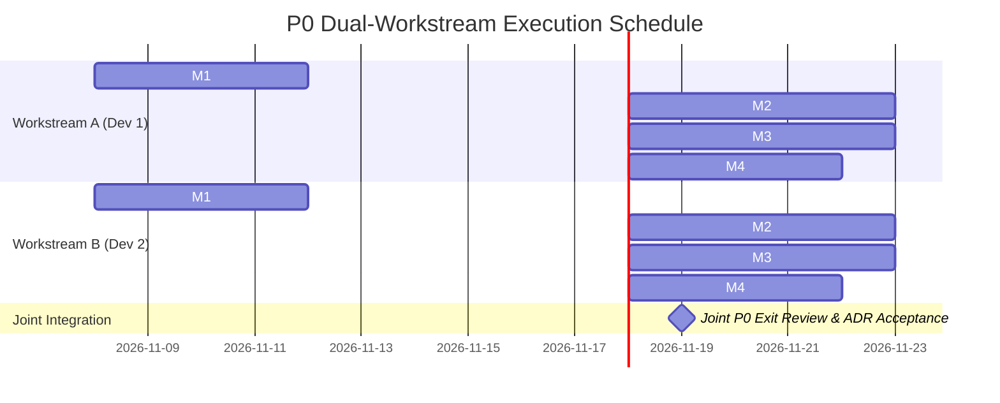

# StrataMQ Delivery Roadmap & Implementation Status

**Tracking Progress from P0 Research to v1 General Availability**  
*Architecture Baseline: November 2026*

---

## 1. Roadmap Phase Overview

| Phase | Description | Status | Target Deliverables |
|---|---|---|---|
| **P0** | **Architecture Validation** | 🟡 **In Progress** | Semantic prototype, Sharding tournament, Storage tournament, Transport tournament, Delivery tournament, RecordBatch v0, NMP Draft 0 |
| **P1** | **Single-Node Production Foundation** | ⚪ Planned | Durable disk WAL, segment roll, sparse indexes, crash recovery, NMP/TCP server, CLI tool |
| **P2** | **Reliability & Recovery** | ⚪ Planned | Producer idempotency table, business idempotency keys, hierarchical timer wheels, DLQ replaying, crash-recovery suites |
| **P3** | **Advanced Messaging** | ⚪ Planned | Isolated replay branches, broker-local atomic operations, causal metadata, priority work schedulers |
| **P4** | **Object Storage & Durability Classes** | ⚪ Planned | S3-compatible segment tier, prefetch/caching, storage class profiles (`low-latency`, `balanced`, `economical`) |
| **P5** | **Mixed-Workload Resource Isolation** | ⚪ Planned | Multi-class resource budget scheduler (CPU, I/O, network, memory) |
| **P6** | **Security & Access Control** | ⚪ Planned | TLS/mTLS, SASL/OAuth2/JWT, Journal & Subscription ACL/RBAC, audit logging |
| **P7** | **Cluster Metadata & Placement** | ⚪ Planned | Metadata consensus, placement epochs, rendezvous shard routing |
| **P8** | **Replication & Failover** | ⚪ Planned | Storage-group replication, leader failover, snapshot transfer, catch-up |
| **P9** | **Cluster Rebalancing** | ⚪ Planned | Node drain/expansion, live shard movement, hot-shard detection |
| **P10**| **Transport Maturity** | ⚪ Planned | QUIC promotion if benchmark-justified; multi-stream multiplexing |
| **P11**| **Compatibility Adapters** | ⚪ Planned | Kafka boundary adapter, AMQP 0-9-1 boundary adapter |
| **P12**| **SDK Ecosystem & v1 GA** | ⚪ Planned | Multi-language SDKs (Go, TypeScript, Python), operational runbooks, backup/restore, v1 GA |

---

## 2. Phase P0 Milestone: Architecture Validation & Dual-Workstream Plan

Phase P0 validates physical architecture choices through reproducible benchmark evidence and empirical tournament reports before freezing assumptions into single-node production code.

### 2.1. Plane Separation & Workstream Division

To enable parallel execution with zero git merge conflicts and independent feedback loops, Phase P0 is organized across StrataMQ's primary architectural boundary: the **State & Networking Plane** and the **Record & Storage Plane**.

```
┌────────────────────────────────────────────────────────────────────────┐
│                   WORKSTREAM A: STATE & WIRE PLANE                     │
│                  (Developer 1: Protocol & Consumption)                 │
│                                                                        │
│   crates/protocol-core  ───>  crates/subscription  ───>  crates/server │
│   - NMP Draft 0 Framing      - Keyed Queue Completion   - TCP Listener │
│   - Demand Windows           - Timer Wheel Retries      - Client API   │
│   - Delivery Tournament      - Transport Tournament                    │
└───────────────────────────────────┬────────────────────────────────────┘
                                    │ Shared Integration Contracts
                                    │ (RecordBatchV0, Clock, Durability)
┌───────────────────────────────────▼────────────────────────────────────┐
│                  WORKSTREAM B: RECORD & STORAGE PLANE                  │
│                   (Developer 2: Persistence & Sharding)                │
│                                                                        │
│   crates/record  ───>  crates/storage-core  ───>  crates/sharding      │
│   - RecordBatch v0     - Local WAL / Hybrid      - Virtual Sharding    │
│   - Codec & CRC32C     - Storage Tournament      - Sharding Tournament │
│   - Fuzz Targets       - Failure Injection       - bench-core Harness  │
└────────────────────────────────────────────────────────────────────────┘
```

#### Workstream Ownership Matrix

| Dimension | **Workstream A: State & Networking** | **Workstream B: Storage & Sharding** |
|---|---|---|
| **Assigned Owner** | **Developer 1** | **Developer 2** |
| **Primary Crates** | [`crates/subscription`](crates/subscription), [`crates/protocol-core`](crates/protocol-core), [`crates/server`](crates/server) | [`crates/record`](crates/record), [`crates/journal`](crates/journal), [`crates/storage-core`](crates/storage-core), [`crates/sharding`](crates/sharding), [`crates/bench`](crates/bench) |
| **Focus Areas** | Wire protocol, demand flow control, leases, retries, client sessions | Batch codecs, disk persistence, virtual sharding, benchmark harness, failure injection |
| **Tournaments Owned** | Transport (`NET-L1`, `NET-W1`), Delivery (`DEL-S1`) | Storage (`STORE-W1`, `STORE-S1`, `STORE-R1`), Sharding (`SHARD-U1`, `SHARD-R1`), Codec (`FORMAT-1`) |
| **ADRs Owned** | `ADR-P0-005`, `ADR-P0-006`, `ADR-P0-010` | `ADR-P0-001`, `ADR-P0-002`, `ADR-P0-003`, `ADR-P0-004`, `ADR-P0-007`, `ADR-P0-008`, `ADR-P0-009` |

---

### 2.2. Shared Integration Contracts

To decouple development, both workstreams adhere to shared Rust contracts declared in `strata-types` and `strata-record`:

1. **Clock Provider (`strata-types`)**: Injectable `Clock` trait returning monotonic timestamps to eliminate wall-clock drift in lease verification and Journal OCC.
2. **`RecordBatchV0` Framing (`strata-record`)**: 32-byte header (`total_len`, `format_version`, `flags`, `compression`, `record_count`, `producer_id`, `producer_epoch`, `first_sequence`, `first_timestamp`, `crc32c`) shared zero-copy between network frame payloads and storage log segments.
3. **Demand Window (`strata-types` / `strata-protocol-core`)**: `DemandWindow { max_records: u32, max_bytes: u32, wait_ms: u32, continuous: bool }` authorizing client credit budgets.

---

### 2.3. P0 Parallel Task Schedule & Tracking Board



| Task ID | Component | Owner | Dependencies | Status | Scope |
|---|---|---|---|---|---|
| **A-01** | Keyed Work Queue Completion & Lifecycle | Dev 1 | None | 🟡 In Progress | Unblock pending items on ACK/DLQ, implement KeyFailurePolicy |
| **A-02** | Work Queue Timer-Wheel Optimization | Dev 1 | None | ⚪ Planned | Replace $O(N)$ linear scans in `expire_leases` / `promote_retries` |
| **A-03** | NMP Frame Header & Framing Codec | Dev 1 | Contract 2 | ⚪ Planned | 24-byte header, defensive parsing boundaries (`max_frame_bytes`) |
| **A-04** | Capability Negotiation (`HELLO`/`WELCOME`)| Dev 1 | A-03 | ⚪ Planned | Session handshake, feature negotiation bitflags |
| **A-05** | Demand Window Flow Accounting | Dev 1 | A-03, A-04 | ⚪ Planned | Receiver credit tracking via `DEMAND` and `WINDOW_UPDATE` |
| **A-06** | TCP Multiplexing Connection Actor | Dev 1 | A-05 | ⚪ Planned | Tokio framed async actor loop for multiplexed NMP streams |
| **A-07** | Delivery Tournament (`DEL-S1`) | Dev 1 | A-05, B-03 | ⚪ Planned | Benchmark demand-window vs pull vs push semantics |
| **A-08** | Transport Tournament (`NET-L1`/`W1`) | Dev 1 | A-06, B-03 | ⚪ Planned | Benchmark NMP/TCP vs NMP/QUIC under packet loss and latency |
| **A-09** | NMP Draft 0 Semantic Closure ([#34](https://github.com/Amppire/stratamq/issues/34)) | Dev 1 | A-03, A-04, A-06 | ⚪ Planned | Freeze exact 24-byte layout, error scopes, retryability, GOAWAY, and reconnect behavior |
| **B-01** | Clock Trait & Monotonic Time Injection | Dev 2 | None | ⚪ Planned | Mockable clock injection in Journal and WorkState |
| **B-02** | `RecordBatchV0` Binary Layout & CRC32C | Dev 2 | Contract 2 | ⚪ Planned | Batch framing, sequence numbers, producer epoch validation |
| **B-03** | Benchmark Core Harness & HDR Latency | Dev 2 | None | ⚪ Planned | Workload generators, HDR histogram samplers, JSON schema |
| **B-04** | Sharding Tournament (Virtual vs Coarse) | Dev 2 | B-03 | ⚪ Planned | Rendezvous hashing vs coarse partition routing benchmarks |
| **B-05** | Storage Tournament (Local vs Hybrid WAL) | Dev 2 | B-02, B-03 | ⚪ Planned | Measure WAL append and commit receipts under load |
| **B-06** | Codec Fuzz Target (`cargo-fuzz`) | Dev 2 | B-02 | ⚪ Planned | Continuous fuzz corpus for RecordBatch decoding |
| **B-07** | Mixed-Workload Isolation (`MIX-1`/`MIX-2`)| Dev 2 | B-05, A-02 | ⚪ Planned | Verify interactive $p99 < 2\times$ baseline during replays |
| **B-08** | Crash Recovery & Failure Injection | Dev 2 | B-05 | ⚪ Planned | SIGKILL, truncated WAL recovery, stale lease fencing |
| **B-09** | Committed Identity Contract ([#32](https://github.com/Amppire/stratamq/issues/32)) | Dev 2 | B-02 | ⚪ Planned | Preserve RecordId across receipt, WAL, recovery, replay, and redelivery |
| **B-10** | Durable State & Recovery Contract ([#35](https://github.com/Amppire/stratamq/issues/35)) | Both | B-01, B-05, B-08 | ⚪ Planned | Freeze subject-head, cursor, ACK/NACK, lease, retry, and keyed recovery outcomes |
| **B-11** | Retention Safety & Phase Boundary ([#33](https://github.com/Amppire/stratamq/issues/33)) | Both | B-05, B-09 | ⚪ Planned | Define safe reclamation invariants and P1/P3/P4 implementation split |
| **J-01** | End-to-End Ingress Integration | Both | A-06, B-02 | ⚪ Planned | Wire NMP frame parsing directly to storage append |
| **J-02** | P0 Architecture Exit Review | Both | All P0 tasks, A-09, B-09, B-10, B-11 | ⚪ Planned | Formal ADR tournament evaluation, semantic closure, and P1 readiness check |

---

### 2.4. Detailed Deliverables Checklist

#### Semantic Prototype Status
- [x] Strongly-typed domain IDs with UUIDv7 ([`strata-types`](crates/types/src/lib.rs))
- [x] Immutable record data model with headers & keys ([`strata-record`](crates/record/src/lib.rs))
- [x] In-memory Journal with per-subject revision tracking & OCC ([`strata-journal`](crates/journal/src/lib.rs))
- [x] Stream subscription state machine with cursor, commit, & seek ([`strata-subscription::StreamState`](crates/subscription/src/stream.rs))
- [x] Work queue state machine with generation-fenced leases, extensions, & retries ([`strata-subscription::WorkState`](crates/subscription/src/work.rs))
- [ ] Complete Keyed work queue lifecycle: promotion of pending items on completion ([`strata-subscription::KeyedWorkState`](crates/subscription/src/keyed.rs))
- [ ] Replace linear lease/retry scans with time-indexed queue or hierarchical timer wheel
- [ ] Property-based testing with `proptest` for concurrent OCC and lease expiration races

#### Record Batch v0 Specification
- [ ] Define `RecordBatchV0` binary layout with length prefixes, CRC32C, producer ID, epoch, sequence, and flags ([`crates/record`](crates/record))
- [ ] Implement LZ4 and Zstandard batch compression codecs
- [ ] Bound decompressed output and compression ratio before allocating ([#31](https://github.com/Amppire/stratamq/issues/31))
- [ ] Freeze publication-versus-committed representation and stable `RecordId` recovery ([#32](https://github.com/Amppire/stratamq/issues/32))
- [ ] Fuzz test decoder with `cargo-fuzz`

#### Native Messaging Protocol (NMP Draft 0)
- [ ] Exact 24-byte frame header codec: `[version, flags, opcode, stream_id, request_id, payload_len, reserved]` ([`crates/protocol-core`](crates/protocol-core))
- [ ] Frame parser with defensive allocation bounds (`max_frame_bytes`, `max_batch_records`)
- [ ] Implement demand-window accounting (`DEMAND` and `WINDOW_UPDATE`)
- [ ] Freeze error scopes, retryability, `GOAWAY`, duplicate request, and reconnect behavior ([#34](https://github.com/Amppire/stratamq/issues/34))

#### Semantic Closure & Recovery Contracts
- [ ] Define durable response and recovery outcomes for publish, subject heads, cursors, ACK/NACK, retries, leases, and keyed state ([#35](https://github.com/Amppire/stratamq/issues/35))
- [ ] Verify record append and per-subject revision-head advancement recover atomically
- [ ] Define retention safety, earliest-available-position errors, and the P1/P3/P4 implementation boundary ([#33](https://github.com/Amppire/stratamq/issues/33))
- [ ] Define authoritative lease-extension behavior for retained or reordered receipts ([#2](https://github.com/Amppire/stratamq/issues/2))

#### Tournament Harnesses & Experiments ([`crates/bench`](crates/bench))
- [ ] **Sharding Tournament**: Compare Coarse Partitions vs. Virtual Sharding (65k/262k) via Rendezvous Hashing (`SHARD-U1`, `SHARD-H1`, `SHARD-R1`)
- [ ] **Storage Tournament**: Compare Local-First WAL vs. Hybrid WAL+Object vs. Object-Primary (`STORE-W1`, `STORE-S1`, `STORE-R1`)
- [ ] **Transport Tournament**: Compare NMP over TCP vs. NMP over QUIC under LAN and WAN packet loss (`NET-L1`, `NET-W1`)
- [ ] **Delivery Tournament**: Compare Request/Response Pull vs. Server Push vs. Demand-Window (`DEL-S1`)
- [ ] **Codec Tournament**: Compare Shared Wire/Storage Batch format vs. Normalized Internal Representation
- [ ] **Mixed-Workload Isolation**: Run mixed stream/work/replay workload (`MIX-1`, `MIX-2`) and evaluate priority class scheduler

---

## 3. P0 Exit Criteria Checklist

Before graduating to Phase P1 (Single-Node Production Foundation), the project must satisfy all criteria from Implementation Plan §17.1:

- [ ] Unified record/subscription model verified under property tests for all subscription modes.
- [ ] Sharding architecture selected with measured routing and rebalancing trade-offs (ADR-P0-001).
- [ ] Default storage commit architecture and durability profiles chosen with benchmark evidence (ADR-P0-003, ADR-P0-004).
- [ ] NMP Draft 0 framing and Record Batch v0 format validated and stabilized.
- [ ] Committed `RecordId` remains stable across receipt, storage, recovery, replay, tier movement, and redelivery (#32).
- [ ] Durable state and crash-recovery outcomes are normative for subject heads, cursor commits, work transitions, and keyed state (#35).
- [ ] NMP Draft 0 has an exact encoded layout and complete minimum error/reconnect contract (#34).
- [ ] Retention safety invariants and later-phase implementation boundaries are accepted (#33).
- [ ] TCP vs. QUIC positioning decided with empirical measurements (ADR-P0-005).
- [ ] Demand-window delivery validated against push/pull implementations (ADR-P0-006).
- [ ] Shared vs. normalized batch representation decided with CPU and copy metrics (ADR-P0-007).
- [ ] Mixed-workload isolation strategy proven to preserve interactive $p99 < 2\times$ baseline (ADR-P0-009).
- [ ] All tournament results captured in reproducible benchmark reports and accepted ADRs.

---

## 4. Phase P1: Single-Node Production Foundation

P1 implements the accepted P0 contracts as a production-capable standalone broker. Full requirements, phase boundaries, dependencies, and exit criteria are defined in the [P1 Technical Specification](architecture/p1-spec.md).

GitHub milestone: [Phase P1: Single-Node Production Foundation](https://github.com/Amppire/stratamq/milestone/2).

| Task | Issue | Owner | Depends On | Status | Scope |
|---|---|---|---|---|---|
| **P1-01** | [#42](https://github.com/Amppire/stratamq/issues/42) | Haris + Shaunak | P0 exit (#18, #32–#35) | ⚪ Planned | Materialize accepted P0 decisions into the single-node architecture |
| **P1-02** | [#38](https://github.com/Amppire/stratamq/issues/38) | Shaunak | P1-01 | ⚪ Planned | Durable WAL append, sync, backpressure, and commit receipts |
| **P1-03** | [#36](https://github.com/Amppire/stratamq/issues/36) | Shaunak | P1-01, P1-02 | ⚪ Planned | Immutable segment roll, checksums, and sparse indexes |
| **P1-04** | [#37](https://github.com/Amppire/stratamq/issues/37) | Shaunak | P1-02, P1-03 | ⚪ Planned | Startup recovery, manifest rebuild, and subject-head restoration |
| **P1-05** | [#41](https://github.com/Amppire/stratamq/issues/41) | Haris | P1-01, P1-02 | ⚪ Planned | Durable stream cursor checkpoints |
| **P1-06** | [#43](https://github.com/Amppire/stratamq/issues/43) | Shaunak | P1-03, P1-04, P1-05 | ⚪ Planned | Basic age/size retention and boundary errors |
| **P1-07** | [#40](https://github.com/Amppire/stratamq/issues/40) | Haris | P1-01, P1-02, NMP Draft 0 | ⚪ Planned | Standalone NMP/TCP runtime and graceful shutdown |
| **P1-08** | [#39](https://github.com/Amppire/stratamq/issues/39) | Haris + Shaunak | P1-04, P1-05, P1-07 | ⚪ Planned | End-to-end publish, stream, and work delivery |
| **P1-09** | [#44](https://github.com/Amppire/stratamq/issues/44) | Haris | All subsystems (P1-01–P1-08) | ⚪ Planned | Configuration, metrics, diagnostics, and operator CLI |
| **P1-10** | [#45](https://github.com/Amppire/stratamq/issues/45) | Haris + Shaunak | P1-02 through P1-09 | ⚪ Planned | Single-node acceptance, load, restart, and exit gate |

### P1 Exit Gate

- [ ] Zero acknowledged-record loss across the single-node crash matrix.
- [ ] Stable record identity, positions, timestamps, and subject revisions across restart.
- [ ] Durable cursor checkpoints and deterministic retention boundaries.
- [ ] Bounded NMP/TCP publish and consumption paths.
- [ ] Crash-consistent segment roll, recovery, and retention deletion.
- [ ] Actionable configuration, metrics, diagnostics, and CLI workflows.

---

## 5. Phase P2: Reliability & Recovery

P2 makes duplicate publication, work delivery, retries, delayed execution, DLQ operations, and recovery deterministic across crashes and hostile storage conditions. Full requirements are defined in the [P2 Technical Specification](architecture/p2-spec.md).

GitHub milestone: [Phase P2: Reliability & Recovery](https://github.com/Amppire/stratamq/milestone/3).

| Task | Issue | Owner | Depends On | Status | Scope |
|---|---|---|---|---|---|
| **P2-01** | [#49](https://github.com/Amppire/stratamq/issues/49) | Shaunak | P1 WAL/recovery (#37, #38, #45) | ⚪ Planned | Durable producer epoch and sequence idempotency |
| **P2-02** | [#48](https://github.com/Amppire/stratamq/issues/48) | Shaunak | P2-01 storage patterns (#49) | ⚪ Planned | Application idempotency keys and deduplication policy |
| **P2-03** | [#53](https://github.com/Amppire/stratamq/issues/53) | Haris | P1 state hooks (#39, #41, #45), #35 | ⚪ Planned | Persistent work, retry, DLQ, and keyed state |
| **P2-04** | [#52](https://github.com/Amppire/stratamq/issues/52) | Haris | P2-03 (#53), #21 | ⚪ Planned | Restart-safe leases, retries, and delayed-delivery timers |
| **P2-05** | [#50](https://github.com/Amppire/stratamq/issues/50) | Haris | P2-03 (#53) | ⚪ Planned | DLQ inspection, replay, and recovery operations |
| **P2-06** | [#47](https://github.com/Amppire/stratamq/issues/47) | Shaunak | P2-01 through P2-04 (#48, #49, #52, #53) | ⚪ Planned | State snapshots, checkpoints, compaction, and bounded recovery |
| **P2-07** | [#54](https://github.com/Amppire/stratamq/issues/54) | Shaunak | P1 recovery (#37), P2-06 (#47) | ⚪ Planned | Disk-full, corruption, stalled-I/O, and repeated-crash hardening |
| **P2-08** | [#46](https://github.com/Amppire/stratamq/issues/46) | Haris | NMP reconnect baseline (#34, #40), P2-01 (#49) | ⚪ Planned | Optional negotiated NMP session resumption or explicit deferral |
| **P2-09** | [#51](https://github.com/Amppire/stratamq/issues/51) | Haris + Shaunak | P2-01 through P2-08 | ⚪ Planned | Reliability, idempotency, recovery, and exit gate |

### P2 Exit Gate

- [ ] Duplicate transport and business requests satisfy their idempotency contracts.
- [ ] Work, retry, DLQ, generation, and keyed state recover deterministically.
- [ ] Lease/retry timing remains correct across restart and wall-clock changes.
- [ ] DLQ replay is bounded, explicit, idempotent, and observable.
- [ ] Checkpoints bound recovery time and metadata growth.
- [ ] Disk-full, corruption, partial-write, stall, and repeated-crash tests fail closed.
